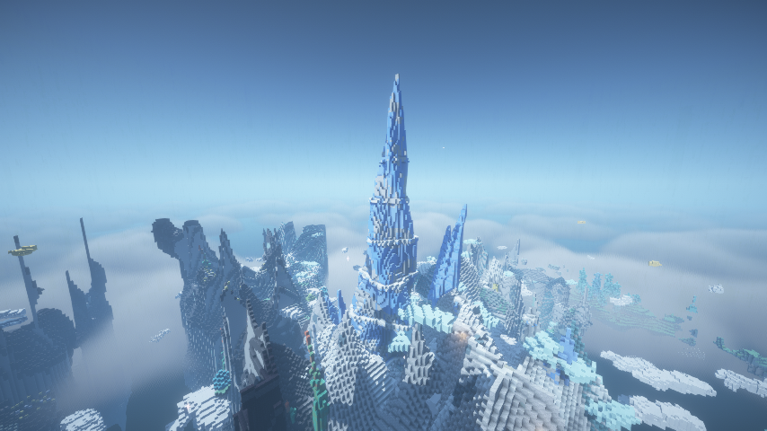

# Altered Aether

A NeoForge addon for [The Aether](https://www.curseforge.com/minecraft/mc-mods/aether) that reshapes the Aether's
worldgen, built to inspire awe and make the Aether worth exploring. It adds a region of new biomes with their own
landforms, lakes and waterfalls, rare landmarks you find by exploring, lightning storms over the peaks, and a
taller Aether.

## Requirements

- Minecraft 1.21.1
- NeoForge 21.1.264 or later
- The Aether 1.5.10 or later
- Aeroblender 1.0.0 or later (and TerraBlender, which it needs)
- Install on both client and server

Every other mod listed below is optional: the content that uses one only loads when that mod is installed (and its
switch in the config's `[compat]` section is on).

## What it adds

**Biomes**, in Altered Aether's own TerraBlender region, so Deep Aether and other Aether worldgen mods keep theirs:

| Biome | Terrain |
|---|---|
| Aether Plateau | a tall tableland of stepped mesas, its ground near y 96 in the tall Aether, with lakes, pools and the odd waterfall off a cliff |
| Frozen Crags | floating mountain massifs along ridgelines, tarns, snow drifts, ice spikes; with the Sky Tundra round them, they stand about 30 blocks above the islands nearby, which climb to meet them |
| Sky Tundra | snowfield plates ringing the crags, with great wind drifts and buried trees |
| Tempest Peaks | rare, broad ranges standing alone in the open sky, apart from the cold lands: needle spires, branching native copper crystals with spidery roots of greening copper spreading through the rock, strike craters, storms |
| Shattered Rift | an island torn apart: a sparse field of tall, blocky columns standing apart, with clouds of rubble hanging in the gaps between them |
| Windswept Dunes | thin sheets of quicksoil winding low through the sky, rippled by long wind ridges, what is left of an island the clouds have blown over: rare, alone in the open sky with the land round them thinning away; ruins, dead bushes |
| Flower Bowl | a meadow basin inside a raised rim, flowers, sometimes a pond |
| Skyroot Cathedral | broad forest islands of giant skyroots standing shoulder to shoulder, joined by roots, layering bows and canopy bridges: hollow elders you can build in, tunnel giants, Tule masses, bow colonies and cathedral rings; trails, lamps and camps |
| Nurselog Hollow | the cathedral's fallen elders, round its edges and now and then alone: colossal fallen logs with walkable hollows and root plates over craters, some flooded into muddy ponds, snags, giant stumps, lattice skeletons and rings of regrowth |
| Blazing, Cascading, Flourishing and Vexing Archwood Groves | Ars Nouveau's archwood forests (need Ars Nouveau) |
| Flashing Archwood Grove | needs Ars Nouveau and Ars Elemental |

**Atolls.** Scattered through the Skyroot Grove, Forest and Woodland and over the Aether Plateau, rings of land are set into the islands round sunlit lagoons: quicksoil beaches, branching coral reefs, glowstone thickets, kelp, tropical fish and glow squid. Some are rings, oval or twisting, with a river round the crown. Each takes the height of the land it sits in, and its underside blends into the island below.

Without Ars Nouveau the grove windows fall back to the Aether's own skyroot biomes. Landforms appear only inside
the region, and blend out at its edges. The holystone under every lake, pool and lagoon bed is richer in zanite and
a little scattered gravitite.

**Giant trees.** Every giant in the two groves is grown from existing Aether wood, never a new block, and each
colony is one clone: its trees share a wood and are tied together by surface roots. With Deep Aether, some colonies
are roseroot, sunroot, cruderoot, yagroot or conberry. Pilgrims once tended the groves: some trails are still trodden
and lit, some camps round an ambrosium campfire still burn, and others are long forgotten. Chests are hidden in
hollows and secret places: sealed in burls, fallen logs and stumps, or in a nest at the top of a trunk. Nothing is
lit by fire, which goes out in the Aether: the lamps are ambrosium torches, and with Deep Aether skyjade lanterns and
tiki torches.

Hand-built **camps and farms** are scattered thinly across the Aether: wayfarers' camps on any level ground, blue berry
farms in the skyroot meadows and forests and on the plateau, and a gleamberry farm in the groves. Some giants have a
**burrow** set into their side: a furnished room, entered by a doorway on the ground. Their blocks from Ascended Quark,
Aether: Beyond Parity, Deep Aether and Visual Workbench are used when those mods are present and give way to Aether or
vanilla blocks (stools become skyroot slabs) when they are not. They live in `data/altered_aether/structure/camp/`;
`camp_site_chance` and `tree_burrow_chance` tune them.

Now and then a Cathedral giant stands in a shallow swamp lake on an islet of its own, its prop roots arching out
through the water into a muddy bed. The lake has lily pads, seagrass and stands of waterlogged yagroot roots
(mangrove roots without Deep Aether), and cattails grow on its shores. Neighbouring lakes may join, and every
giant that stands in one gets its own islet. The water of both grove biomes is a murky swamp green.

Rarely a colossal stump in the Nurselog Hollow holds a spring. Its heart is a brimming pool, and the water spills
through notches in the rim and down grooves worn in the flanks. It ends in a mire choked with roots round the foot.
Wherever the water runs, the bark is worn away and the bare grain lies the way the water flows. The wet top is green
with grass and saplings.

The Nurselog Hollow's islands are coming apart with no living roots left to hold them. Here and there a bite of an
island's edge has broken off and drifted out, sunk and tipped. Across the gap lies the hollow giant whose fall began
it, with its last roots sagging beneath. Much more rarely a fissure of open sky runs right across an island.

Both groves hold the stonework of the people who came before the pilgrims, all holystone and moss and unlit. There
are cottage shells broken to different heights, the stump of a keep with its curtain walls, and rings of standing
stones with trilithons inside.

Out on the Aether Plateau, rarely, a row of one to three great stone heads stands sunk to their chins in the turf,
all gazing the same way.

`/altered_aether giant <type>` finds the nearest giant of a kind (including `spring_stump`), `giant mire` the
nearest swamp lake, and `giant break_edge` or `giant break_chasm` the nearest break. `/altered_aether ruin <kind>`
builds a ruin (`cottage`, `keep`, `circle` or `head`) where you stand. All three are for operators only.

**Rare landmarks:**

- **Tempest crown**: a cluster of storm-black needles rising far above Tempest Peaks, crowned with lightning rods
  and ringed with copper crystals. The storms strike it first.
- **Frozen spire**: one colossal twisted spire of ice in the crags, ringed with snowy ledges.
- **Grand cascade**: a staircase of pools stepping down to an island's edge, each spilling into the next, the last
  pouring off into the sky.
- **Great fracture**: a canyon across the rift, its slabs grown into giant plates, one side heaved up over the other.
- **Double atoll**: an atoll standing alone in open sky among the skyroot islands, with a second ring in its lagoon
  and a golden oak on an islet at its heart.
- **The Grandfather**: the Skyroot Cathedral's ancestor tree, some 140 blocks tall, every kind of giant in one: a
  tunnel through its foot, a ring of children risen from its bows, and over the tunnel, up one of the bows, a room
  lined with golden oak heartwood.
- **Deserted village tree**: a squat Skyroot Cathedral tree, wider than it is tall, with a canopy some 90 blocks
  across.
  - A street runs round its trunk, cut back under the overhang of the bulb above, with railings along the ledge.
  - Rounded houses are grown into the heartwood off the street, with a burl swelling round each doorway, and two
    passages lead to the atrium: a tall dome through both storeys, with long plank tables, lanterns, glowstone
    dripping from the crown, an altar at its head, and with Deep Aether, totems set into the walls.
  - A ramp winds up inside the wall to a second gallery and a balcony over the atrium. From there a ladder climbs
    to the top of the bulb, where the villagers' fields lie overgrown round its neck: squash vines and berry bushes,
    now and then a patch of overworld crops.
  - Half the time it stands in a broad swamp that reaches out as far as the ground allows, a crescent on a small
    island. The old stone ruins out in it stand on islets of their own, or have sunk into the water.
  - The people are long gone: a bed here, a freezer there, crates of junk, dark lanterns over the street. Now and
    then one nitwit still lives in a house.
  - The ruins of their older stone houses lie round its foot among young trees.

`/altered_aether landmark <type>` finds the nearest one (operators only).

**Tempest storms**: storm cells drift over Tempest Peaks and strike the high ground near players, with a warning
of sparks and thunder first. Lightning rods take strikes as in vanilla. Explosions and scorch marks respect
`mobGriefing`. Clients see flashes in the distance, rain, sparks and storm fog. With Sable, the storms never single
out anyone riding a ship: no strike is drawn by their copper or metal or aimed at the ground under them.

**Ambrosium campfire**: a campfire of skyroot and ambrosium that burns in the Aether. Aether: Beyond Parity's
campfire is replaced by it when that mod is installed.

**Gleam vines**: cave vines in Aether colours that hang from the giants' bows and canopies, lit by gleamberries. Hung from leaves, they take on those leaves' colour (client config `gleam_vine_leaf_tint`).
The berries are eaten like glow berries, foxes pick them and bees grow the vines.

**Tamed aerwhales.** Break one in like a horse. Blue gummy swets calm a wild aerwhale (it follows anyone holding one).
Then climb on with an empty hand and hold on: it flies you about and dives where there's room, until it either
accepts you or throws you off, higher than you'd ever leap. The calmer it is, the likelier it keeps you, and each
rider it throws calms it a little more. A wild calf can't be ridden, so swets alone tame it.
- Saddled, an adult seats four, and whoever climbs on first steers. Its back is a deck you can walk around on while
  it flies, and whatever stands there is carried along. Unsaddled it carries one rider and stays put.
- Fly it by looking where you want to go. The dive key (J by default) charges a dive, and the leap key (space by
  default; both under Altered Aether in Controls) throws you off upward at the whale's speed. The whale coasts on
  long enough for you to land back on it, then goes back to whatever you'd told it to do.
- Sneak and use it to cycle stay, wander and follow. The inventory key, while riding, opens its saddle and
  saddlebag.
- Blue and golden gummy swets heal it, and holding one draws it to you from far off. Enchanted berries breed two
  whales, and an Aether spawn egg used on any aerwhale makes a calf.
- With Deep Aether installed its own aerwhales (saddle, chest, two seats) are used instead if you prefer them:
  `use_deep_aether_aerwhales` in the config's `[aerwhales]` section. Server and players must match.

**Unsaddling**: sneak and use an empty hand on a saddled phyg or flying cow to take its saddle back.

**Gravitite golems.** A storage sorter that works by telekinesis. Place a carved pumpkin (or a Deep Aether carved
squash) on a block of enchanted gravitite standing on holystone, and a thin, big-headed golem sits down there in
meditation. That spot is its home.
- **Linking storage.** Use the golem with an empty hand to take its storage pebble. Use the pebble on chests, barrels
  and other storage to link them (the chest doesn't open, and briefly glows), and again to unlink. Hoppers and
  Create's depots are only ever emptied, never filled. Machines can't be linked. A golem reaches 16 blocks out and
  half that up and down.
- **Sorting.** When something in its storage changes, the golem concentrates and items glide one stack at a time
  from chest to chest. An item never leaves its chest until it lands in the next: nothing is lost if the golem is
  interrupted, killed or unloaded mid-flight. Chests a player has open are left alone. Once it is done, it chimes,
  and plain chests and barrels are also ordered inside.
- **Modes.** Sneak and use the golem with an empty hand to switch. *Tidy* files items into families: where they
  come from (the Aether, the overworld, the nether, the end), what they are (blocks, resources, equipment, food,
  mechanisms) and what they are made of, read off their recipes, tags and names (spruce stairs, planks and stripped
  logs are all spruce; cooked food is apart from raw). Armour, tools and weapons are one equipment family,
  wherever they come from. It sorts as finely as there are chests for: a family that fills a quarter of a chest
  gets one of its own, and chests to spare go to smaller families of two stacks or more; the rest share with their
  kin (spruce with the other wood), and what fits nowhere finer goes with the odds and ends. *Compact* packs
  everything into as few chests as it fits in. An item frame on a chest pins that item, and its family, to that
  chest in either mode; a glow item frame or a Create placard pins only that item and moves everything else out.
- **Special storage.** Drawers (Functional Storage, Storage Drawers) are bulk storage: each keeps what it holds, and
  an empty one is given whatever fills the most stacks; compacting drawers are only filled. Quark crates take the
  odds and ends first. With Create, a brass funnel putting items into a machine can be linked: the golem keeps the
  machine fed with what the funnel's filter lets through (nothing without one), and a Create filter in an item frame
  or on a placard pins everything it lets through.
- **Finding things.** Use the golem with any item to see which linked chests hold it, with the total above the
  hotbar. Use its own pebble on it to see everything linked for 15 seconds. While you hold its pebble you see the
  edge of its reach and motes over linked storage, and the tooltip shows its mode and links.
- **Moving it.** Sneak and use the pebble on the top of a block to send the golem there; it walks, levitates up
  steps, floats across gaps, and sits down there as its new home. Anything else that moves it, it walks back from.
- **Teams.** Golems of one colour sitting within reach of each other work as one network (6 by default; dye a
  golem to recolour it); together they cover all their areas and pass items between them.
- **Care.** Six hearts. It pushes everything near it away when struck (players gently), and is otherwise peaceful;
  monsters ignore it. Ambrosium shards heal it. A redstone signal makes it rest. It drops its holystone, and half
  the time its enchanted gravitite.
- With Jade installed, looking at a golem shows its mode, links and what it is doing or waiting on; looking at
  linked storage shows its golem, its pin, and the family tidy mode keeps it for. JEI has a page on the pebble and
  spawn egg.

### Boulders

Stone breaks off the islands above and falls. Some of it did long ago, and some still does.

- **Ancient boulders.** Half-buried in the ground, their stone mossed over, in every Aether biome, with or without Sable.
  Each holds an ore (see below).
- **Falling boulders (with Sable).** Now and then, about every half hour for each player in the Aether (configurable),
  a boulder is made at the top of the world some way from them, after a rumble and a fall of grit, and drops under
  Sable's physics. It hurts what it hits, heavily but not always fatally, and when it comes to rest it is ordinary
  blocks again, set on the block grid; whatever doesn't fit is dropped as an item. It rarely falls over the void, and
  with Create Simulated it falls through the "end sea" that holds ships up while everything else is treated as before
  (the tall Aether moves that sea down to the world's floor). A boulder someone breaks a block of is let go and is just
  another Sable body. Watching one land earns the *Rockfall* advancement.
- **What is in them.** Mostly holystone, sometimes icestone and, with Deep Aether, aseterite and clorite. Each carries
  one ore: one of the Aether's own, or more often one that another Aether biome generates and the one it lands in
  doesn't. Gravitite ore is never one of them. The tag
  `#altered_aether:boulder_ore_blacklist` keeps ores out.
- **Claims.** With FTB Chunks, a boulder never drops on, settles in or hurts anyone in a claim whose team has turned off
  mob griefing or explosion damage, and neither does it touch a structure; one that rolls into such land vanishes in dust.

### Clouds that give way (with Sable)

Airships, contraptions and falling boulders pass straight through aerclouds, the Aether's and Deep Aether's, without
slowing or breaking them. The clouds they touch, and those a block around, turn faint and fade back in over 15 seconds
(configurable), then are the same clouds as before. A cloud only gives way to Sable bodies and to whoever is riding
one: anyone else still stands, bounces and drifts on it as usual, so the crew on an open deck isn't pushed off as the
ship sails through, while a player on the cloud beside it doesn't fall. Clouds built into a ship collide as any block does.

## The tall Aether

The built-in datapack **Altered Aether: Tall Aether** (on by default) makes the Aether -64..319 like the Overworld,
with deeper islands and room for the tallest landmarks. Turn it off in the Data Packs screen when creating a world
for the stock 0..255 Aether. The height can't change once a world's Aether has been generated.

With the tall pack, other mods' Aether structures and ores are moved to the matching heights automatically.

The tall Aether also has a **cloud sea**: a rolling sheet of cold aercloud at about y -35..-8 under every region's
plain islands, level with the dunes. The bigger islands plunge through it, sky lakes and holes break it up, and it
gives way to our landforms. Falling water washes its own way down through the cloud. About one in five of the
Highlands' islets wears a **cloud skirt**, a collar of the same cloud round its rim.

## Optional mods

### Highly encouraged

| Mod | What it brings |
|---|---|
| Deep Aether | its stones, blocks and ground cover in our biomes (closest Aether or vanilla blocks stand in without it); totems, carved squash, tiki torches; poison pools; giant-tree colonies of its woods, skyjade lanterns, glowing vines and moss in the groves |
| Aether Overworld Ores | its ores placed by biome; 42 enchanting recipes |

### Notable

| Mod | What it brings                                                                                                                                                                                                                                        |
|---|-------------------------------------------------------------------------------------------------------------------------------------------------------------------------------------------------------------------------------------------------------|
| Ars Nouveau | the archwood groves, scattered archwood, familiars and wilden in the groves; archwood is taken out of the overworld (Ars Elemental's too) unless `disable_overworld_archwood` is off                                                                  |
| Ars Elemental | the Flashing Archwood Grove, flashjacks, sirens, sourcestone boulders                                                                                                                                                                                 |
| Create | zinc in Tempest Peaks; placards and filters pin items for gravitite golems, depots are emptied by them, and brass funnels into machines are fed by them                                                                                                                                                                                                                                 |
| Quark | gravitite golems put the odds and ends in crates first, and sort chests with Quark's own sort |
| Functional Storage, Storage Drawers | gravitite golems keep drawers as bulk storage |
| Oreganized | silver in the crags and the rift                                                                                                                                                                                                                      |
| Dried Ghast | dried ghast fields in the Windswept Dunes                                                                                                                                                                                                             |
| Snuffles | Snuffles in the Frozen Crags, and only in the Aether (configurable)                                                                                                                                                                                   |
| Mowzie's Mobs | nagas in Deep Aether's Yagroot Swamp; lanterns in the Skyroot Cathedral and Deep Aether's Luminescent Forest                                                                                                                                                           |
| Integrated Villages | its airship village in the Aether, and no longer in the overworld (configurable)                                                                                                                                                                      |
| Aether: Beyond Parity | its ambrosium campfire is replaced                                                                                                                                                                                                                    |
| Sable | falling boulders; ships pass through aerclouds; gravitite lifts (enchanted gravitite only while powered)                                                                                                                                                  |
| Create Simulated (Create Aeronautics) | falling boulders pass through its void-holding "end sea" while ships don't; the tall Aether's end sea is lowered to the world's floor                                                                                                              |
| FTB Chunks | falling boulders keep out of claims protected from griefing                                                                                                                                                                                          |

Mobs added to the Aether from other mods spawn only in the Aether by default (each has an `aether_exclusive`
switch). Breezes are the exception: they spawn in the Aether as well as anywhere vanilla puts them, and only standing
on cold aerclouds.

## Configuration

`config/altered_aether-common.toml`. Every value is commented with its default and range.

- `[region]`: the region's weight and each biome on or off.
- `[terrain]`: landform strengths, rift fracture size and drift, dune height and wind, atoll size,
  `landmark_rarity` (higher is rarer, 0 turns landmarks off), and the cloud skirts and cloud seas on or off, with the
  share of breezes that spawn on each.
- `[basins]`: each kind of lake on or off and its rarity, waterfall frequency, coral density.
- `[groves]`: giant spacing, golden heartwood chance, the share of Deep Aether wood colonies, camp and secret-chest
  chances, the share of trails and camps still tended, and the chance and size of the swamp lakes (`mire_chance`,
  `mire_size`). Also the spring stumps (`spring_stump_chance`), ruins (`ruin_chance`, `stone_head_chance`), the
  village tree's nitwit and swamp (`village_nitwit_chance`, `village_mire_chance`), flooded fallen-giant craters
  (`flooded_crater_chance`) and the island breaks (`grove_break_chance`,
  `grove_chasm_share`).
- `[features]`: a density multiplier per decoration family.
- `[spawns]`: per added mob: on or off, `aether_exclusive`, weight, group size and spawn cost.
- `[climate]`: the biome temperature fix.
- `[storms]`: everything about the Tempest storms.
- `[gravitite_golem]`: reach, golems per network, links per golem, how many slots a network reads, flight time,
  items in the air at once, how often storage is checked, the push when struck, healing and how far a golem can be
  sent; for tidy mode, the share of a chest a family must fill to get its own (`min_group_fill`), the fewest stacks
  worth a drawer (`bulk_min_stacks`) and which mods count as the Aether (`aether_namespaces`).
- `[boulders]`: minutes between falling boulders per player (0 turns them off), how many at once, the chance one is
  dropped over the void, and the damage they do. How many ancient boulders there are is `ancient_boulders` under
  `[features]`.
- `[phased_aerclouds]`: how many seconds a cloud a Sable body passed through takes to fade back in (`fade_seconds`,
  15 by default).
- `[tall_mode]`: structures the tall Aether should leave at their own heights.
- `[compat]`: one switch per optional mod, the Beyond Parity campfire swap, and `disable_overworld_archwood`.

`config/altered_aether-client.toml`: storm fog, sky flashes, local rain, particle density, how the effects adapt
to shaderpacks, and for gravitite golems the glow colour, whether it shows through walls (off by default), how long
it lasts, flying items on or off, and fewer particles.

## Shaders

The atmospheric effects are made to work under Iris shaderpacks, and are tested with BSL v10.1.1 (Iris 1.8.14,
Sodium 0.8.13): the flashes are real lightning to the shaderpack, and the storm's rain and thunder levels drive its
wetness and darkening. Storm fog is left to the shaderpack when one is active. See
[docs/shaders.md](docs/shaders.md).

## Performance

Measured with the dev server's benchmark: a fresh world on one seed, the same 484 chunks in four places, the tall
Aether, on an i7-13700KF; and with `/altered_aether fly`, a server-side stand-in for a player crossing 6,000 blocks at
40 blocks a second with a view distance of 10.

| | 1.3.0 | This version |
|---|---|---|
| Generation, no other mods | 25.6 ms per chunk | 35.5 ms |
| Generation, with ByePregen, Deep Aether, Lithium and a pack's worth of other mods | 23.5 ms | 36.6 ms |
| Flying: chunks missing near the player, on average | 0 | 0 |
| Flying: longest server tick | 2.4 s | 1.0 s |

The stock-height Aether is quicker still, at about 24 ms per chunk with no other mods. This version does a good deal
more than 1.3.0 (cloud skirts and seas, big lakes, caves, the Highlands, sea stacks, nadirite), and still keeps up
with flight.

Minecraft works out structures and places features one chunk at a time; only the terrain itself is shared out among
the worker threads. So what costs time while exploring is the work done in those steps, and Altered Aether keeps it
small:

- every site search (lakes, stacks, caves, landmarks) is cached per world;
- the terrain probes that site searches use sample each 2D noise once per column;
- the cloud skirts' collars are worked out ahead, on threads of their own.

With ByePregen installed, its compiled terrain evaluator handles our terrain
too.

Rules for keeping it this way when adding terrain or features: [docs/worldgen-performance.md](docs/worldgen-performance.md).

## Development

The Aether and the mods it needs (Aeroblender, TerraBlender, Accessories, owo-lib), and Create and JEI to compile
against, come from [Modrinth's Maven](https://support.modrinth.com/en/articles/8801191-modrinth-maven); their versions
are in `gradle.properties`. Gradle copies them into each run's `mods` folder.

Optional mods to test with go in `libs/optional/` (not committed) and are copied into the runs; Deep Aether and
Lithium come from Modrinth's Maven instead. `-PoptionalMods=all`, `none`, or a comma-separated list of jar name
prefixes or Modrinth project names (`-PoptionalMods=deep-aether,lithium`) picks which. Client and server runs default
to all of them, the GameTest server to none.

The debug tooling (`debug/`) and the GameTests (`gametest/`) live in the `dev` source set, `src/dev/`: every run
loads it, but the released jar is built from `src/main` alone, and `.\gradlew build` fails if any of it gets in.

- `.\gradlew runClient`, `.\gradlew runServer`, `.\gradlew build`.
- Client runs load Iris and Sodium from `libs/shaders/` (not committed) with the BSL shaderpack from `run/shaderpacks/`,
  selected through `run/config/iris.properties`. `-Pshaders=false` runs the client without them.
- Client runs also load the play-testing mods in `libs/client/` (not committed): JEI, Jade, Immersive Overlays and Xaero's Minimap and World Map, all
  from the World Traveler 2 instance. `-PclientMods=false` runs the client without them.
- `.\gradlew runData` regenerates `src/generated/resources` (worldgen, tags, models, lang).
- `.\gradlew test` runs the unit tests, including the biome table's partition across every combination of mods.
- `.\gradlew runGameTestServer` runs the GameTests on a headless server and exits with the number that failed.
- GitHub Actions (`.github/workflows/build.yml`) builds and runs the unit tests, checks `runData` leaves
  `src/generated` unchanged, and runs the GameTests twice: with no optional mods, and with Deep Aether and Lithium.

Worldgen tools, all on the dev server:

- `-PaaBench=radius[,biome|x:z|landmark:<type>|giant:<type>|giant:mire|break:<edge|chasm>|core:<biome>]` generates
  that many chunks around a point, logs the time per chunk, surface, decoration, basin and landmark tallies, then
  stops. `-PaaRender=true` also writes top and side views of the area to `run-server/renders/`. For `giant:`,
  `break:` and `landmark:village_tree` it adds slices through the site, and for the village tree, plans of its two
  galleries.
- `-PaaReport=radius,step` prints a report of biomes, masks and columns.
- `/altered_aether debug` (dev runs only, like `report` and `fly`) reports the biome, climate point, region mask, basin, landmark and storm at your position.
- `-PaaTour=stop,stop,...` on the client quick-plays `run/saves/tour` and screenshots each landmark (and `storm`,
  `campfire`, `biome:<name>`, `giant:<type>`) into `run/screenshots/tour/`.
- `/altered_aether fly <from> <to> <speed> [radius]` (run in the Aether, e.g. through RCON) moves a chunk ticket
  along a line like a flying player and logs tick times, chunks generated and how many near it are still missing.
- `-PaaPerf=fingerprint,bench,chunkhash,fly,spark,jfr` (with `-PaaPerfTag=<name>` and `-PaaWorld=<fresh world>`)
  measures worldgen for before/after comparisons and writes to `run-server/perf/`; `/altered_aether fingerprint`
  hashes the terrain of a running world. `tools/perf/compare.py` and `tools/perf/JfrAgg.java` read the results. See
  [docs/worldgen-performance.md](docs/worldgen-performance.md).
- `python tools/parity/parity.py` compares the biomes with the World Traveler 2 datapack they replace.

## License

Altered Aether is free software under the GNU General Public License, version 3 or (at your option) any later
version. See [LICENSE](LICENSE).

## Credits

The incoming-lightning warning sound is a royalty-free electricity effect from
[Fesliyan Studios](https://www.fesliyanstudios.com/royalty-free-sound-effects-download/electricity-197).
