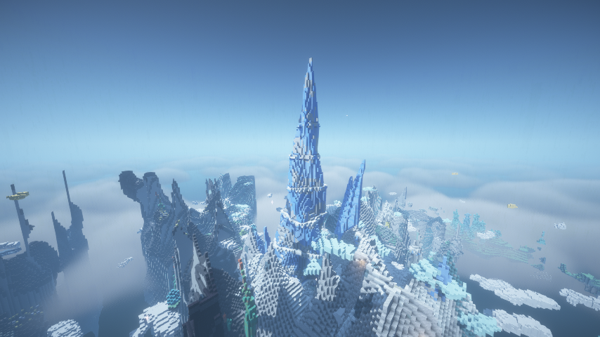

# Altered Aether

A NeoForge addon for [The Aether](https://www.curseforge.com/minecraft/mc-mods/aether) that reshapes the Aether's
worldgen, built to inspire awe and make the Aether worth exploring. It adds a region of new biomes with their own
landforms, lakes and waterfalls, rare landmarks you find by exploring, lightning storms over the peaks, and a
taller Aether.

## Requirements

- Minecraft 1.21.1
- NeoForge 21.1.264 or later
- The Aether 1.5.10 or later
- Aeroblender 1.0.0 or later (and TerraBlender, which it needs)
- Install on both client and server

Every other mod listed below is optional: the content that uses one only loads when that mod is installed (and its
switch in the config's `[compat]` section is on).

## What it adds

**Biomes**, in Altered Aether's own TerraBlender region, so Deep Aether and other Aether worldgen mods keep theirs:

| Biome | Terrain |
|---|---|
| Aether Plateau | stepped mesas with lakes, pools and the odd waterfall off a cliff |
| Frozen Crags | floating mountain massifs along ridgelines, tarns, snow drifts, ice spikes |
| Tempest Peaks | the crags' sharpest summits: needle spires, branching native copper crystals with spidery roots of greening copper spreading through the rock, strike craters, storms |
| Shattered Rift | an island torn apart: a sparse field of tall, blocky columns standing apart, with clouds of rubble hanging in the gaps between them |
| Windswept Dunes | thin sheets of quicksoil winding high through the sky, rippled by long wind ridges; ruins, dead bushes |
| Skyroot Cathedral | broad forest islands of giant skyroots standing shoulder to shoulder, joined by roots, layering bows and canopy bridges: hollow elders you can build in, tunnel giants, Tule masses, bow colonies and cathedral rings; trails, lamps and camps |
| Nurselog Hollow | the cathedral's fallen elders, round its edges and now and then alone: colossal fallen logs with walkable hollows and root plates over craters, some flooded into muddy ponds, snags, giant stumps, lattice skeletons and rings of regrowth |
| Blazing, Cascading, Flourishing and Vexing Archwood Groves | Ars Nouveau's archwood forests (need Ars Nouveau) |
| Flashing Archwood Grove | needs Ars Nouveau and Ars Elemental |

**Atolls.** Scattered through the Skyroot Grove, Forest and Woodland and over the Aether Plateau, rings of land are set into the islands round sunlit lagoons: quicksoil beaches, branching coral reefs, glowstone thickets, kelp, tropical fish and glow squid. Some are rings, oval or twisting, with a river round the crown. Each takes the height of the land it sits in, and its underside blends into the island below.

Without Ars Nouveau the grove windows fall back to the Aether's own skyroot biomes. Landforms appear only inside
the region, and blend out at its edges. The holystone under every lake, pool and lagoon bed is richer in zanite and
a little scattered gravitite.

**Giant trees.** Every giant in the two groves is grown from existing Aether wood, never a new block, and each
colony is one clone: its trees share a wood and are tied together by surface roots. With Deep Aether, some colonies
are roseroot, sunroot, cruderoot, yagroot or conberry. Pilgrims once tended the groves: some trails are still trodden
and lit, some camps round an ambrosium campfire still burn, and others are long forgotten. Chests are hidden in
hollows and secret places: sealed in burls, fallen logs and stumps, or in a nest at the top of a trunk. Nothing is
lit by fire, which goes out in the Aether: the lamps are ambrosium torches, and with Deep Aether skyjade lanterns and
tiki torches.

Now and then a Cathedral giant stands in a shallow swamp lake on an islet of its own, its prop roots arching out
through the water into a muddy bed. The lake has lily pads, seagrass and stands of waterlogged yagroot roots
(mangrove roots without Deep Aether), and cattails grow on its shores. Neighbouring lakes may join, and every
giant that stands in one gets its own islet. The water of both grove biomes is a murky swamp green.

Rarely a colossal stump in the Nurselog Hollow holds a spring. Its heart is a brimming pool, and the water spills
through notches in the rim and down grooves worn in the flanks. It ends in a mire choked with roots round the foot.
Wherever the water runs, the bark is worn away and the bare grain lies the way the water flows. The wet top is green
with grass and saplings.

The Nurselog Hollow's islands are coming apart with no living roots left to hold them. Here and there a bite of an
island's edge has broken off and drifted out, sunk and tipped. Across the gap lies the hollow giant whose fall began
it, with its last roots sagging beneath. Much more rarely a fissure of open sky runs right across an island.

Both groves hold the stonework of the people who came before the pilgrims, all holystone and moss and unlit. There
are cottage shells broken to different heights, the stump of a keep with its curtain walls, and rings of standing
stones with trilithons inside.

Out on the Aether Plateau, rarely, a row of one to three great stone heads stands sunk to their chins in the turf,
all gazing the same way.

`/altered_aether giant <type>` finds the nearest giant of a kind (including `spring_stump`), `giant mire` the
nearest swamp lake, and `giant break_edge` or `giant break_chasm` the nearest break. `/altered_aether ruin <kind>`
builds a ruin (`cottage`, `keep`, `circle` or `head`) where you stand. All three are for operators only.

**Rare landmarks**, each one-in-many:

- **Tempest crown**: a cluster of storm-black needles rising far above Tempest Peaks, crowned with lightning rods
  and ringed with copper crystals. The storms strike it first.
- **Frozen spire**: one colossal twisted spire of ice in the crags, ringed with snowy ledges.
- **Grand cascade**: a staircase of pools stepping down to an island's edge, each spilling into the next, the last
  pouring off into the sky.
- **Great fracture**: a canyon across the rift, its slabs grown into giant plates, one side heaved up over the other.
- **Double atoll**: an atoll standing alone in open sky among the skyroot islands, with a second ring in its lagoon
  and a golden oak on an islet at its heart.
- **The Grandfather**: the Skyroot Cathedral's ancestor tree, some 140 blocks tall, every kind of giant in one: a
  tunnel through its foot, a ring of children risen from its bows, and over the tunnel, up one of the bows, a room
  lined with golden oak heartwood.
- **Deserted village tree**: a squat Skyroot Cathedral tree, wider than it is tall, with a canopy some 90 blocks
  across.
  - A street runs round its trunk, cut back under the overhang of the bulb above, with railings along the ledge.
  - Rounded houses are grown into the heartwood off the street, with a burl swelling round each doorway, and two
    passages lead to the atrium: a tall dome through both storeys, with long plank tables, lanterns, glowstone
    dripping from the crown, an altar at its head, and with Deep Aether, totems set into the walls.
  - A ramp winds up inside the wall to a second gallery and a balcony over the atrium. From there a ladder climbs
    to the top of the bulb, where the villagers' fields lie overgrown round its neck: squash vines and berry bushes,
    now and then a patch of overworld crops.
  - Half the time it stands in a broad swamp that reaches out as far as the ground allows, a crescent on a small
    island. The old stone ruins out in it stand on islets of their own, or have sunk into the water.
  - The people are long gone: a bed here, a freezer there, crates of junk, dark lanterns over the street. Now and
    then one nitwit still lives in a house.
  - The ruins of their older stone houses lie round its foot among young trees.

`/altered_aether landmark <type>` finds the nearest one (operators only).

**Tempest storms**: storm cells drift over Tempest Peaks and strike the high ground near players, with a warning
of sparks and thunder first. Lightning rods take strikes as in vanilla. Explosions and scorch marks respect
`mobGriefing`. Clients see flashes in the distance, rain, sparks and storm fog.

**Ambrosium campfire**: a campfire of skyroot and ambrosium that burns in the Aether. Aether: Beyond Parity's
campfire is replaced by it when that mod is installed.

**Gleam vines**: cave vines in Aether colours that hang from the giants' bows and canopies, lit by gleamberries.
The berries are eaten like glow berries, foxes pick them and bees grow the vines.

**Tamed aerwhales.** Feed a wild aerwhale blue berries and now and then it's yours (it follows anyone holding them).
- Saddled, an adult seats four, and whoever climbs on first steers. Its back is a deck you can walk around on while
  it flies, and whatever stands there is carried along. Unsaddled it carries one rider and stays put.
- Fly it by looking where you want to go. Jump charges a dive, and the leap key (J by default, under Altered Aether
  in Controls) throws you off upward at the whale's speed. The whale coasts on long enough for you to land back on
  it, then turns to follow you.
- Sneak and use it to cycle stay, wander and follow. The inventory key, while riding, opens its saddle and
  saddlebag.
- Blue and golden gummy swets heal it, and holding one draws it to you from far off. Enchanted berries breed two
  whales, and an Aether spawn egg used on any aerwhale makes a calf.
- With Deep Aether installed its own aerwhales (saddle, chest, two seats) are used instead if you prefer them:
  `use_deep_aether_aerwhales` in the config's `[aerwhales]` section. Server and players must match.

## The tall Aether

The built-in datapack **Altered Aether: Tall Aether** (on by default) makes the Aether -64..319 like the Overworld,
with deeper islands and room for the tallest landmarks. Turn it off in the Data Packs screen when creating a world
for the stock 0..255 Aether. The height can't change once a world's Aether has been generated.

With the tall pack, other mods' Aether structures and ores are moved to the matching heights automatically.

## Optional mods

| Mod | What it brings |
|---|---|
| Ars Nouveau | the archwood groves, scattered archwood, familiars and wilden in the groves; archwood is taken out of the overworld (Ars Elemental's too) unless `disable_overworld_archwood` is off |
| Ars Elemental | the Flashing Archwood Grove, flashjacks, sirens, sourcestone boulders |
| Deep Aether | its stones, blocks and ground cover in our biomes (closest Aether or vanilla blocks stand in without it); totems, carved squash, tiki torches; poison pools; giant-tree colonies of its woods, skyjade lanterns, glowing vines and moss in the groves |
| Aether Overworld Ores | its ores placed by biome; 42 enchanting recipes |
| Create | zinc in Tempest Peaks |
| Oreganized | silver in the crags and the rift |
| Dried Ghast | dried ghast fields in the Windswept Dunes |
| Snuffles | Snuffles in the Frozen Crags, and only in the Aether |
| Mowzie's Mobs | nagas in the Aether; lanterns in the Skyroot Cathedral and Deep Aether's Luminescent Forest |
| Integrated Villages | its airship village in the Aether, and no longer in the overworld |
| Aether: Beyond Parity | its ambrosium campfire is swapped for ours |

Mobs added to the Aether from other mods spawn only in the Aether by default (each has an `aether_exclusive`
switch). Breezes are the exception: they spawn in the Aether as well as anywhere vanilla puts them, and only standing
on cold aerclouds.

## Configuration

`config/altered_aether-common.toml`. Every value is commented with its default and range.

- `[region]`: the region's weight and each biome on or off.
- `[terrain]`: landform strengths, rift fracture size and drift, dune height and wind, atoll size, and
  `landmark_rarity` (higher is rarer, 0 turns landmarks off).
- `[basins]`: each kind of lake on or off and its rarity, waterfall frequency, coral density.
- `[groves]`: giant spacing, golden heartwood chance, the share of Deep Aether wood colonies, camp and secret-chest
  chances, the share of trails and camps still tended, and the chance and size of the swamp lakes (`mire_chance`,
  `mire_size`). Also the spring stumps (`spring_stump_chance`), ruins (`ruin_chance`, `stone_head_chance`), the
  village tree's nitwit and swamp (`village_nitwit_chance`, `village_mire_chance`), flooded fallen-giant craters
  (`flooded_crater_chance`) and the island breaks (`grove_break_chance`,
  `grove_chasm_share`).
- `[features]`: a density multiplier per decoration family.
- `[spawns]`: per added mob: on or off, `aether_exclusive`, weight, group size and spawn cost.
- `[climate]`: the biome temperature fix.
- `[storms]`: everything about the Tempest storms.
- `[tall_mode]`: structures the tall Aether should leave at their own heights.
- `[compat]`: one switch per optional mod, the Beyond Parity campfire swap, and `disable_overworld_archwood`.

`config/altered_aether-client.toml`: storm fog, sky flashes, local rain, particle density, and how the
effects adapt to shaderpacks.

## Shaders

The atmospheric effects are made to work under Iris shaderpacks, and are tested with BSL v10.1.1 (Iris 1.8.14,
Sodium 0.8.13): the flashes are real lightning to the shaderpack, and the storm's rain and thunder levels drive its
wetness and darkening. Storm fog is left to the shaderpack when one is active. See
[docs/shaders.md](docs/shaders.md).

## Performance

Measured with the dev server's benchmark: fresh worlds with the same seed, 225 chunks around each of two points,
twice each. The baseline is the same mod with its worldgen switched off in the config (region weight 0, no
landmarks, no basins), so the terrain is the stock Aether's.

| Area | Stock terrain | Altered Aether | Cost |
|---|---|---|---|
| Around 0, 0 | 28.3 ms per chunk | 35.1 ms | +24% |
| Around 3000, -2000 | 16.1 ms | 17.0 ms | +6% |

Overall the difference is about 18%. Most of it goes on the extra terrain the plateau's mesas and the groves'
islands put where stock islands leave sky: more blocks to surface, light and decorate.

Exploring keeps up with flight: a server-side stand-in for a player crossing 11,000 blocks at 30 blocks a second
(`/altered_aether fly`) has every chunk near it generated in time, at an average tick of under 4 ms.

The Skyroot Cathedral's forest islands cost about the same as the plateau, for the same reason. The giants
themselves are cheap: planning and building every giant in a 289-chunk benchmark takes 2 to 3 seconds of worker
time in all (the benchmark reports it as `ms/grove_plan` and `ms/grove_build`).

## Development

The Aether and the mods it needs are not committed. Copy these from the CurseForge instance's `mods` folder into
`libs/`:

- `aether-1.21.1-1.5.10-neoforge.jar`
- `aeroblender-1.21.1-1.0.0-neoforge.jar`
- `TerraBlender-neoforge-1.21.1-4.1.0.8.jar`
- `accessories-neoforge-1.1.0-beta.54+1.21.1.jar`
- `owo-lib-neoforge-0.12.15.6-beta.1+1.21.jar`

Optional mods to test with go in `libs/optional/` and are copied into the runs; `-PoptionalMods=none` (or a
comma-separated list of jar name prefixes) picks which.

- `.\gradlew runClient`, `.\gradlew runServer`, `.\gradlew build`.
- Client runs load Iris and Sodium from `libs/shaders/` (not committed) with the BSL shaderpack from `run/shaderpacks/`,
  selected through `run/config/iris.properties`. `-Pshaders=false` runs the client without them.
- Client runs also load the play-testing mods in `libs/client/` (not committed): JEI, Jade, Immersive Overlays and Xaero's Minimap and World Map, all
  from the World Traveler 2 instance. `-PclientMods=false` runs the client without them.
- `.\gradlew runData` regenerates `src/generated/resources` (worldgen, tags, models, lang).
- `.\gradlew test` runs the unit tests, including the biome table's partition across every combination of mods.

Worldgen tools, all on the dev server:

- `-PaaBench=radius[,biome|x:z|landmark:<type>|giant:<type>|giant:mire|break:<edge|chasm>|core:<biome>]` generates
  that many chunks around a point, logs the time per chunk, surface, decoration, basin and landmark tallies, then
  stops. `-PaaRender=true` also writes top and side views of the area to `run-server/renders/`. For `giant:`,
  `break:` and `landmark:village_tree` it adds slices through the site, and for the village tree, plans of its two
  galleries.
- `-PaaReport=radius,step` prints a report of biomes, masks and columns.
- `/altered_aether debug` reports the biome, climate point, region mask, basin, landmark and storm at your position.
- `-PaaTour=stop,stop,...` on the client quick-plays `run/saves/tour` and screenshots each landmark (and `storm`,
  `campfire`, `biome:<name>`, `giant:<type>`) into `run/screenshots/tour/`.
- `/altered_aether fly <from> <to> <speed> [radius]` (run in the Aether, e.g. through RCON) moves a chunk ticket
  along a line like a flying player and logs tick times, chunks generated and how many near it are still missing.
- `python tools/parity/parity.py` compares the biomes with the World Traveler 2 datapack they replace.

## License

Altered Aether is free software under the GNU General Public License, version 3 or (at your option) any later
version. See [LICENSE](LICENSE).

## Credits

The incoming-lightning warning sound is a royalty-free electricity effect from
[Fesliyan Studios](https://www.fesliyanstudios.com/royalty-free-sound-effects-download/electricity-197).
